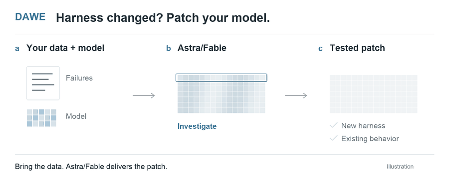

# DAWE

**Bring your data and model. Astra/Fable investigates failures, derives small weight edits, and delivers tested patches.**



[Static overview](docs/assets/dawe-workflow.png) · [Read the story](docs/WRITEUP.md)

DAWE (Data-Attributed Weight Editing) is an agent skill for fixing model behavior with small weight edits. Give it logs, conversations,
tool traces, or corrected examples, point it at your checkpoint, and describe what should change.
Astra/Fable is the editing agent; your checkpoint is the model it repairs. It prepares the data,
investigates the failure, derives candidate edits, and tests that the fix preserves behavior that already works.

One use case: your harness evolves after post-training, and the model breaks on the new reply format.
[Read the story →](docs/WRITEUP.md)

## Use it

Clone the repo and install the local tools (Python 3.11+ and uv):

```bash
git clone https://github.com/bandr-ai/dawe.git
cd dawe
uv sync
```

Open the repo in Astra/Fable and give it this:

```text
Read skills/dawe/SKILL.md and use DAWE.

My data is in /path/to/data.
My model checkpoint is /path/to/checkpoint.
Fix: [describe the behavior you want to change].
Preserve: [describe what already works].

Handle the data preparation and evaluation. Inspect the files first and
propose a compute budget before paid work. Return a tested patch, the
results, and the scripts used to produce it. Stop GPU resources when done.
```

That's the starting point. You don't need to choose layers, label decision tokens, or convert your logs
by hand. The agent adapts the workflow to your data and model. It needs accessible weights and reliable
correct answers or a verifier; it asks for missing essentials after inspecting what you supplied.

You get a report, evaluation results, and—when an edit passes the checks—a checkpoint-bound `.gpatch`.
Apply it to a new checkpoint directory:

```bash
uv run dawe patch apply /path/to/fix.gpatch --source /path/to/checkpoint --out /path/to/patched-model
```

Use that directory with your compatible inference runtime. Keep the original checkpoint; the patch can
also be undone with `dawe patch restore`.

DAWE is experimental. It accepts different data sources through the agent, but a successful small edit
is not guaranteed for every failure. The worked experiment below repaired structural output failures;
it does not establish general reasoning or knowledge repair.

[Full user guide](docs/USAGE.md) · [The skill](skills/dawe/SKILL.md) · [No-GPU example](examples/dawe/README.md)

## Install the skill elsewhere

You can also copy the bundled skill into your agent's configured skills directory:

```bash
uv run dawe skill install --dest /path/to/your/skills
```

For explicit local preparation, use `dawe workbench init` and `dawe workbench freeze`; the agent can run
these for you. Preparation starts no compute. Keep private data, runs, and checkpoints out of Git.

## What we have demonstrated

Qwen3.5-4B, LoRA SFT on BFCL under harness `v1`; 204 held-out items, greedy, one run each
([RESULTS.md](RESULTS.md)):

| | `v1` | `v4_format` (XML calls) | `v11_plan` (plan first) | Weights changed |
|---|---|---|---|---|
| fine-tuned on `v1` | 87.7 | 73.5 | 20.1 | none |
| + agent patch for `v4` | 87.7 | 85.8 | 64.2 | 2,557 |
| + agent patch for `v11` | 87.7 | 85.8 | 88.2 | 5,064 |
| retrain from base on XML only | 73.0 | 89.7 | not run | all |
| retrain from base on plan-first only | 90.2 | 82.8 | 88.7 | all |

The plan-first patch also uses XML development states; its XML result is not unseen-harness transfer.
Single run, 204 items (about ±5 points), our own scorer rather than BFCL's, no unconditional-bias control yet. See
[Limitations](docs/EXPERIMENT.md#limitations) before quoting these.

## Start here

| I want to... | Go to |
|---|---|
| see the story from baseline to patch to evaluation | [docs/WALKTHROUGH.md](docs/WALKTHROUGH.md) |
| check what is and is not claimed | [docs/EXPERIMENT.md](docs/EXPERIMENT.md) |
| re-run it | [docs/REPRODUCE.md](docs/REPRODUCE.md) |
| use or inspect a patch | [docs/PATCH_FORMAT.md](docs/PATCH_FORMAT.md), [release/](release/) |
| read what the agents did | [sessions/](sessions/) |
| understand the lab's guarantees | [docs/LAB.md](docs/LAB.md) |
| know the licenses and model/dataset terms | [docs/LICENSES.md](docs/LICENSES.md) |

## Try the tooling without a GPU

```bash
uv sync --extra dev
uv run dawe fetch
uv run pytest -q
uv run dawe splits
uv run python examples/patch_lifecycle.py
```

This checks the pinned dataset, frozen split, harness roundtrips, and sparse patch lifecycle. One known
native-format label mismatch (`simple_307`) is a strict expected failure in the tests; an unexpected pass
also fails CI. `uv run dawe roundtrip` prints the full diagnostic and still exits nonzero on that case.
See [reproduction](docs/REPRODUCE.md) for the research runs and [the synthetic example](examples/dawe/README.md)
for local run preparation.

## What's in a patch?

A `.gpatch` stores changed weight indices and their old/new values, bound to the exact checkpoint by
content hashes. It refuses other checkpoints, applies into a new directory, and supports byte-for-byte
restoration. The patch tools use the Python standard library; model diagnosis and editing need a
separately configured model runtime.

```bash
uv run dawe patch inspect /path/to/fix.gpatch
uv run dawe patch apply /path/to/fix.gpatch --source CHECKPOINT --out PATCHED
uv run dawe patch restore /path/to/fix.gpatch --patched PATCHED --out RESTORED
```

The two [research patches](release/) are 23.6 KB and 43.7 KB. They require our exact research checkpoint,
which is not published. Run DAWE on your checkpoint to produce your own patch. See [the format guide](docs/PATCH_FORMAT.md).

## Contribute

The most useful next step is an independent run on a different model or failure. Bring examples with
trustworthy targets, include behavior to preserve, and report per-item baseline/patched results—even
when no edit works. Share only data and weights you have permission to publish. The [experiment details](docs/EXPERIMENT.md#not-yet-done)
lists the missing research controls; the [user guide](docs/USAGE.md) explains the run artifacts.

## Credits

Data: Yan, Mao, Ji, Zhang, Patil, Stoica, Gonzalez, *Berkeley Function Calling Leaderboard* (2024), Apache-2.0.
Model: Qwen3.5-4B, Apache-2.0. Ideas: *The Surprising Effectiveness of Deleting Weights in LLM Post-Training* (arXiv 2611.10866) and
*Sparks of Weight-Space Programming* (Takehi et al., 2026). Details and terms: [docs/LICENSES.md](docs/LICENSES.md).

## License

Code: [Apache-2.0](LICENSE). The model and dataset have their own terms, listed separately in
[docs/LICENSES.md](docs/LICENSES.md). Contents of `sessions/` were written by an AI agent; see the open item there.
