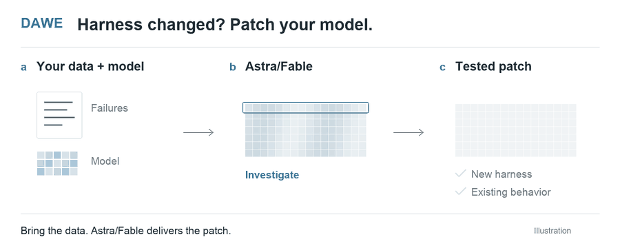

# Ship a harness update. Ship a model patch too?

You post-train a model on your agent's traces. It works. Then you change the harness and things
start breaking.

Maybe you move tool calls from JSON to XML. Maybe you ask the model to write a plan before calling
a tool. Same task, slightly different setup. But the model you just trained doesn't quite follow.

Do you train it again every time?

We wanted to try something smaller: give an agent the failing examples and the model's weights.
Let it figure out what broke and see if a small edit can fix it.

That's **DAWE**. Bring your data and model. **Astra/Fable investigates the failure and tries to
produce a tested weight patch.**



## What actually broke?

The harness is everything around the model: tool definitions, instructions, how calls are formatted,
how replies get parsed. A model trained inside one setup might struggle when that setup changes.

In our experiment, a request needed two tool calls. The model could make both in the old JSON
format. Switch to XML and it made the first call, then stopped.

```text
Needed                          Got

<tool_call>first</tool_call>     <tool_call>first</tool_call>
<tool_call>second</tool_call>    [ends turn]
```

That felt like a useful place to start. Did the model lose the ability to make the second call?
Or was it just choosing to stop too early?

## Let Astra/Fable look inside

The work on [weight-space programming](https://rikiyat.github.io/blog/weight-space-programming/)
got us thinking about this. An agent can inspect another model's weights and write code to change
them. Could we use that to help a post-trained model follow a new harness?

Astra/Fable is the editing agent here. The model being repaired was Qwen3.5-4B, post-trained on
function-calling examples under a JSON harness.

We gave the agent failing examples, the expected behavior, and examples that should keep working.
It could run the model and inspect its internal states within a limited compute budget.

The loop was pretty simple:

1. Find the decision where the reply goes wrong.
2. Inspect the model there and derive a candidate weight edit.
3. Run it again. Check whether the failure is fixed and the old behavior still works.

There was no gradient-descent fine-tuning loop. The agent wrote code to calculate the edits directly
from the examples. And a better token score wasn't enough. We checked the replies it generated.

## A few weights made a difference

We tried twelve harness variants. Renaming things and changing prompts had smaller effects.
XML calls and plan-first replies broke much more.

For XML, the model's later internal states still carried a strong signal about whether another call
should follow. But it picked the end-of-turn token anyway.

The agent used those states to calculate an edit to that token's weight row. The idea: stop less
often when another call is needed, while keeping real stopping points working. For plan-first
replies, it also edited the row for the opening `<` token.

The XML patch changed **2,557 weight values in one row**. Plan-first changed **5,064 across two rows**.
That's the whole edit. The [technical write-up](EXPERIMENT.md#what-the-patches-are) covers the fit and
why this explanation of the internal states is still an interpretation, rather than a causal proof.

Here are the results on 204 held-out items, with the same generation settings before and after:

| Harness change | Before | After its patch | Weights changed |
|---|---:|---:|---:|
| XML tool calls | 73.5% | 85.8% | 2,557 |
| Plan before tool calls | 20.1% | 88.2% | 5,064 |

Accuracy on the old format stayed at **87.7%** with either patch.

A random edit to the same XML row, matched in norm, dropped accuracy to 68.1%. So just nudging that
row wasn't enough. Retraining from the base model on the new harness reached 89.7% for XML and
88.7% for plan-first. The XML patch didn't get all the way there. Plan-first came close in this run.

The patches fit into roughly **24 KB and 44 KB** files. They record the changed positions and the
old/new values, so you can inspect or undo them. Each patch belongs to the exact checkpoint it was
made for.

One detail matters: these scores came from the original lab edits. We checked that converting them
to sparse patch files and applying/restoring them works, but haven't rerun held-out generation
through that exported-patch path.

## So what can we say so far?

A harness change broke this model. Astra/Fable found small weight edits that recovered much of the
lost performance, with old-format accuracy unchanged on our evaluated items. That's encouraging.

It's also one model, one benchmark subset, single runs, and our own scorer. Although test items were
held out, aggregate test scores appeared in the agents' briefs. We still need controls like a
constant logit bias and another training seed. The [limitations](EXPERIMENT.md#limitations) are in
the repo alongside the [results](../RESULTS.md).

Our original idea was bigger: take the difference between models trained under two harness versions
and transfer that difference to another task's model. **We haven't shown that.** These patches used
new-harness examples and were derived for one checkpoint.

But shipping a harness release with model patches is still the thing we want to explore. This was
a first test of whether a small repair could work at all.

## Try it on your model

For now, DAWE is a [skill in the repo](../skills/dawe/SKILL.md). Open it in Astra/Fable and give it
something like this:

```text
Read skills/dawe/SKILL.md and use DAWE.
My data is in /path/to/data. My model is /path/to/checkpoint.
Fix: [what broke]. Preserve: [what already works].
Inspect the data first and propose a compute budget before paid work.
Return the tested patch, evaluation results, and scripts.
```

You need accessible weights and examples with reliable targets or a way to check the answers.
The agent investigates, tries edits, and evaluates them. If an edit passes the checks, you get a
`.gpatch` for your checkpoint. If it doesn't, you get the findings.

The [user guide](USAGE.md) explains setup and applying the patch. We still need an independent
end-to-end run of this workflow on someone else's model. The experiment above is what we've
measured so far.

If your harness changed and your model started doing something weird, that's the kind of failure
we'd like to try next.

---

Inspired by [Sparks of Weight-Space Programming](https://rikiyat.github.io/blog/weight-space-programming/)
and [Deletion Tuning](https://arxiv.org/abs/2611.10866). Our focus here is the harness experiment.
The [experiment details](EXPERIMENT.md), [walkthrough](WALKTHROUGH.md), and
[reproduction instructions](REPRODUCE.md) have the full record.
